# Hermes Legion

**See what your Hermes bots are doing, coordinate their work with a Captain, and follow their progress through desktop characters.**

An independent open-source companion kit for [Hermes Agent](https://github.com/NousResearch/hermes-agent), with reviewed source patches, operating skills, and role templates.

[**v0.36.0 · Owner Inbox and Work Cards**](docs/release-notes-v0.36.0.md) · [**MIT license**](LICENSE) · [**Mac quick start**](#quick-start-on-mac) · [**Changelog**](CHANGELOG.md)

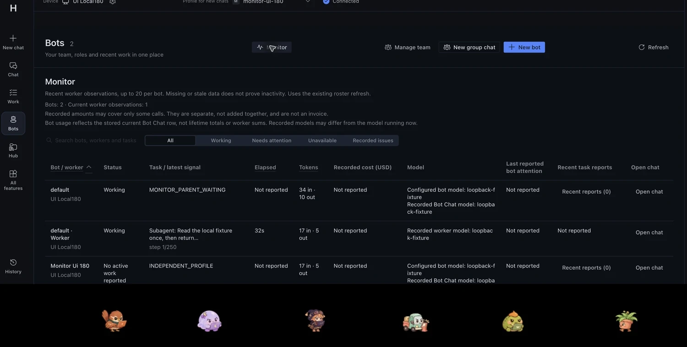

*Composite of two isolated Mac Local demos using synthetic bot activity and original character art.*

## Quick start on Mac

1. Use this source checkout or extract the v0.36.0 source ZIP from [Releases](https://github.com/ap08960695/hermes-legion/releases). Run this in Terminal from the source directory.

   ```sh
   python3 scripts/verify_release.py
   ```

2. With a working Hermes installation, follow the [macOS guide](docs/macos-install-update.md). It checks the pinned upstream source, applies one matching patch, and rebuilds Desktop in a separate trial directory.
3. Use a fresh trial home and app data with **Local** as the only Desktop connection. Turn on **Characters** in the title bar, or open **Bots → Monitor** for a table of current work and reports. The [install and rollback guide](docs/installation-and-rollback.md) covers restoring or removing the trial.

Want to try the planner first? This example only needs Python and uses synthetic work. It prints a proposed plan without starting bots.

```sh
python3 scripts/legion_plan.py --team examples/team.full.json \
  --snapshot examples/snapshots/synthetic-ready.json \
  --tasks examples/scenarios/parallel-production.json --now 1
```

## What you get

The screenshots use isolated demo profiles with fixture data. Preview features are from the working source tree and may require a newer Desktop build than the tagged kit.

### Bot Monitor

Find the bot or worker that needs attention. Search by bot, worker, or task, filter by state, and sort columns such as elapsed time. Rows show the latest known step, model, and recorded usage when available. **Recent reports** opens saved outcomes, and **Open chat** returns you to the conversation. [Monitor guide and evidence](docs/design-bot-monitor.md)

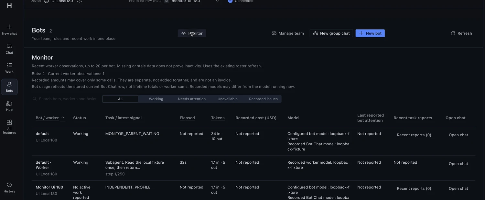

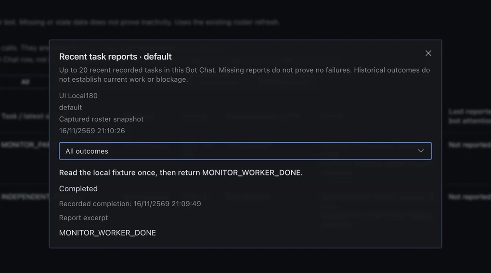

### Captain controls · Preview

In **Settings → Safety → Captain autonomy**, choose whether a profile can set its own goal or delegate routine decisions. These are separate permissions. Configured limits and the owner's approval and pause controls still apply. [Captain autonomy design and verification](docs/design-captain-autonomy.md)

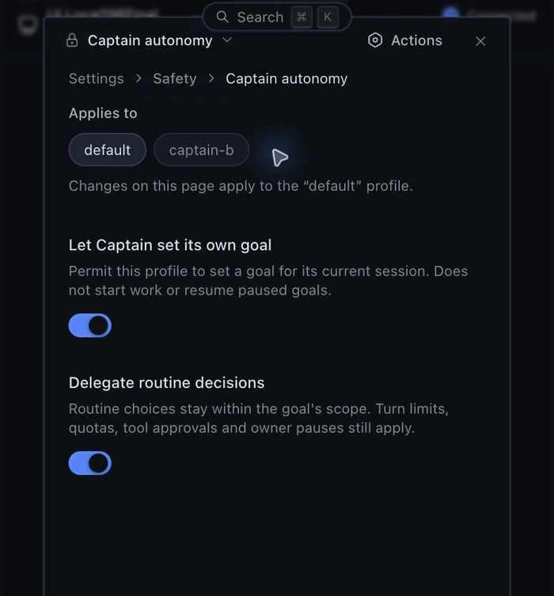

### Desktop Characters

Turn **Characters** on and choose a size in the title bar or from the macOS menu bar, even while Hermes is minimized. Preferences follow the active connection and profile. Characters wander at their own pace. Drag one to another spot or use Reduce Motion for quieter movement. Select an active character to see its latest output or return to its conversation with **Open in Hermes**. [Desktop Characters release notes](docs/release-notes-v0.35.0.md)

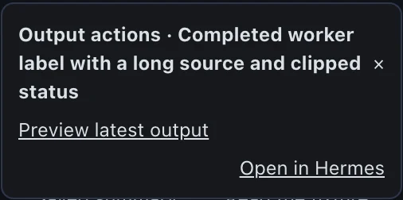

<details>
<summary>Watch the pets arrive and leave (9-second GIF)</summary>


*Isolated Local overlay recording with a staged bot roster.*

</details>

### Make your own character

Start with the blank pack template and your own art. Run `hermes pets validate` to check the pack, `hermes pets show --pack … --cycle --once` to preview its states, then `hermes pets import` to add it. Assign the new pack in **Bots → Edit profile**. [Character creator guide, template, and original example](docs/character-pack.md)

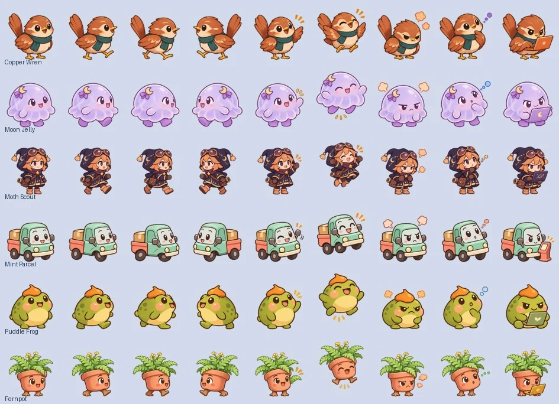

### agent-desktop computer use · Preview

The opt-in provider can read an app's accessibility tree as named elements and short-lived references. On a patched build, run `hermes computer-use status --backend agent-desktop` to check discovery and permissions. The capture shown here used an isolated Hermes window on Mac. [Setup, permission checks, and supported actions](docs/design-agent-desktop.md)

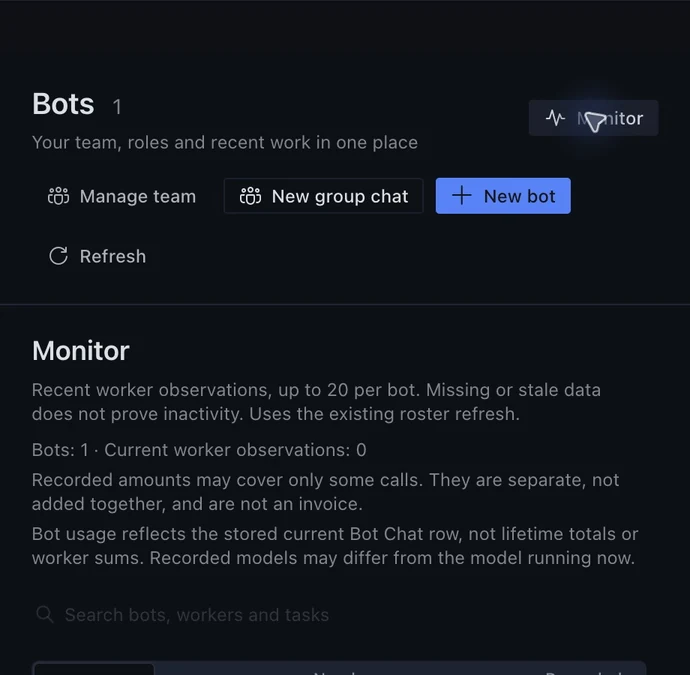

### PDF, Markdown, and CSV previews · Preview

Open a delivered PDF in the built-in viewer, or glance at Markdown and CSV content from a character's latest output. The fixture below shows Markdown and CSV as readable source text. [Rich answers and supported formats](docs/rich-answers.md)

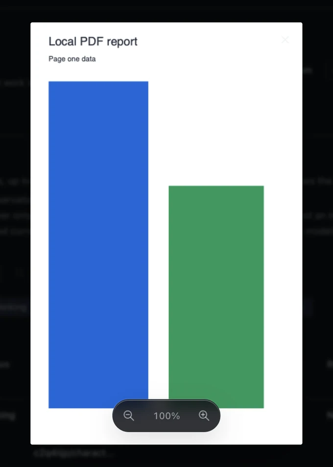

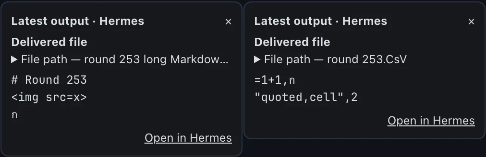

## What changed

| Before | After |
| --- | --- |
| **Opaque overlay.** The backing covered the test window.  | **Transparent overlay.** The test backdrop shows through around the same sprites.  |
| **Placeholder blocks.** Early builds used simple markers.  | **Generated pets.** Six distinct packs on the frameless overlay.  |
| **Separate bot cards.** You opened individual cards for context. 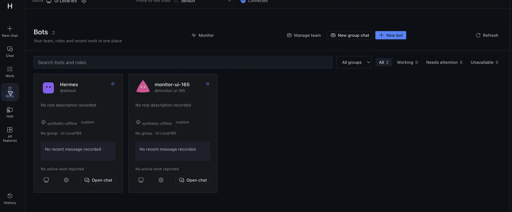 | **One table.** Bot and worker activity can be searched, filtered, and sorted together.  |
| **Before manual refresh.** A fixture sprite read timed out. 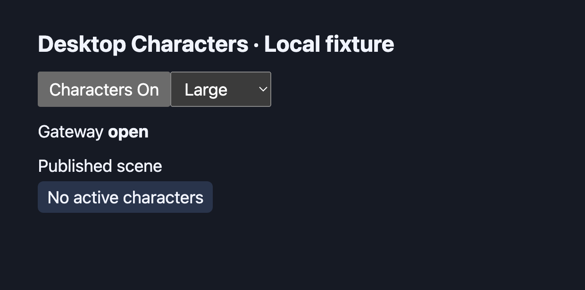 | **After Refresh Characters.** The fixture actor returns. 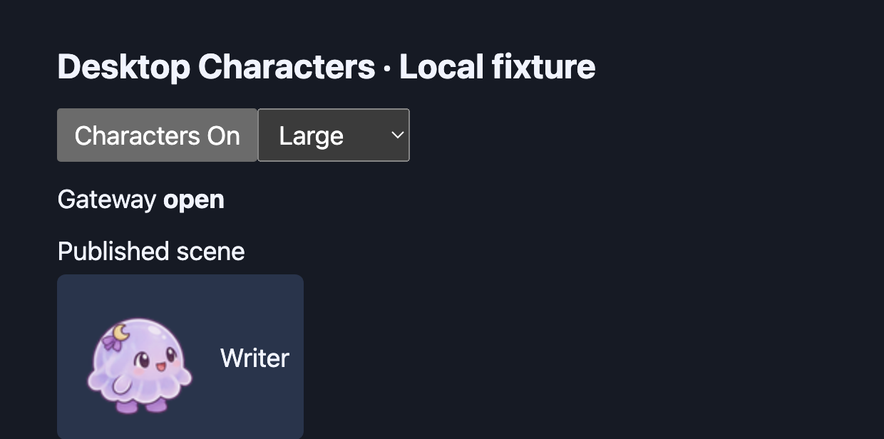 |

[Owner Inbox and Work Cards in v0.36.0](docs/release-notes-v0.36.0.md) · [Desktop Characters in v0.35.0](docs/release-notes-v0.35.0.md) · [Bot Monitor in v0.34.0](docs/release-notes-v0.34.0.md) · [Full changelog](CHANGELOG.md)

## FAQ

### Does the source kit update my existing Hermes.app?

The Mac guide builds a separate trial app and leaves your current app and data in place.

### How do Local and ai differ?

Local uses the gateway on this Mac. The ai option refers to a separately configured remote backend. This walkthrough and the screenshots use Local. Remote resource and reconnect acceptance is still separate.

### Why is a character or button missing?

Check that your trial uses the v0.35.0 source kit or later, **Characters** is on, and the assigned pack is installed in the active profile. If a temporary gateway error hid an assigned character, use **Refresh Characters** in the macOS menu bar or **Refresh** in Bots.

### Why is agent-desktop unavailable?

Use the status command to check the binary and macOS Accessibility permissions. The [provider guide](docs/design-agent-desktop.md) covers explicit paths, app scope, and troubleshooting.

[Source kit index](docs/source-kit-index.md) · [Team and role templates](docs/team-workflow.md) · [Verification](docs/verification.md) · [Security](SECURITY.md) · [Third-party notices](THIRD_PARTY_NOTICES.md)
