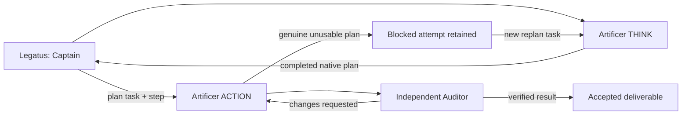

# Captain routing for paired role bots

Apply the [stable role workflow extension](stable-role-workflows.md) first. Add
these rules to your own Captain's instructions at a normal session boundary;
preserve existing conversation prefixes and active workers.

1. Choose the job, then an eligible pair for that job. Inspect reciprocal native
   `bot_workflow` settings, fleet admission, tools, account readiness, shared quota,
   confidentiality, project and approval gates. A role label grants no permission.
   Keep each bot's saved model; choose a stronger eligible thinker only when the
   task warrants it. Provider refusal parks that lane without paid fallback.
2. Create one THINK task with outcome, workspace, acceptance, dependencies and
   constraints. Include the ACTION tools needed for verification. THINK inspects
   and plans; it returns native `metadata.role_plan`, not an implementation or a
   long conversation transcript. Ask the owner only for material missing input,
   authority, irreversible effects or unapproved cost.
3. On that exact task's completion event, read the durable plan once. Create each
   step for its paired ACTION with `plan_task` and `plan_step`, carrying workspace
   and review constraints. Native idempotency reuses an existing matching card.
   Create prerequisites first; start eligible independent scopes together within
   existing account, writer, resource and project limits.
4. ACTION follows its pinned step and verifies acceptance. Preserve independent
   review on the same card. Routine corrections stay with ACTION; an unusable
   plan requires a genuine block and a new same-role THINK task with `replan_of`.
   Keep the old attempt; do not reopen or replay it to manufacture a clean result.
5. Wait for native completion/block events. Stop after successful terminal
   handoff; do not add status-model calls or frequent polling. Continue eligible
   independent work before waiting. Report completion, new failure or required
   owner action. A passing step never waives review, privacy, rights or publishing.

For an already specified small task, an eligible legacy execution bot can work
directly. A strict ACTION bot still requires a genuine completed THINK plan.
Do not create a dummy plan or broaden quota/concurrency to bypass that contract.

Example names below are public Legion identities. Keep the corresponding native
pair linked and use your own eligible provider/model choices:

