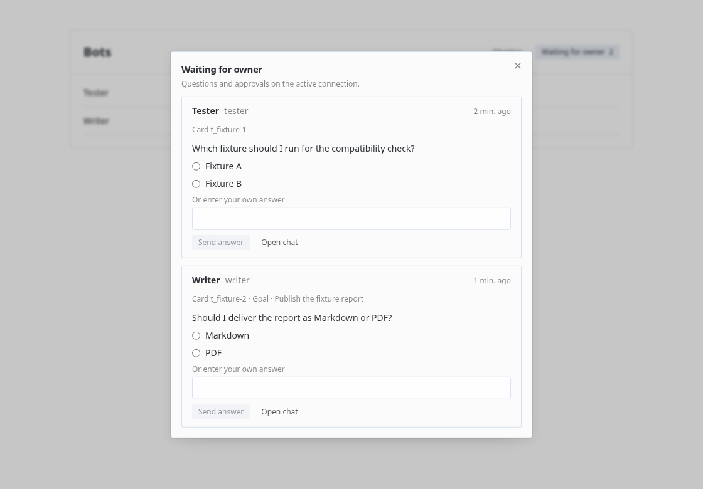
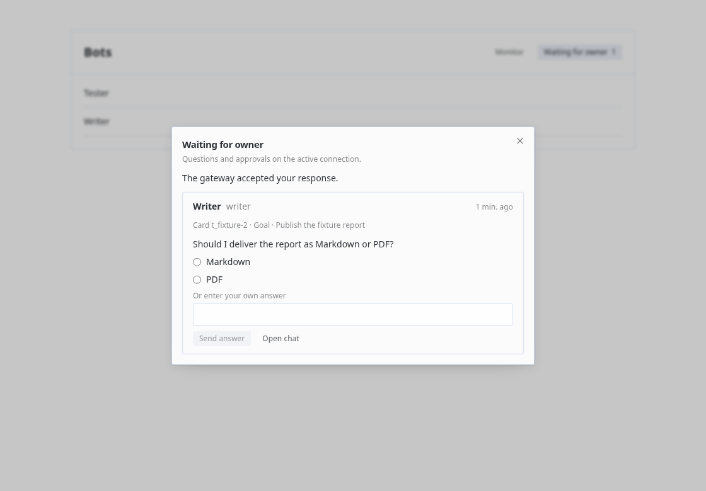

# Bot Monitor

Status: scoped Local capability accepted for the v0.34.0 source-kit handoff.
Commit/tag/publication and owner-app adoption remain separate actions. Historical
development records below retain their original limits; [release scope](release-notes-v0.34.0.md) is current.


## Release gate audit — 2026-11-17

**Ready for the scoped v0.34.0 source-kit handoff.** Product code is based on
kit `2706aab`; later native acceptance uses unchanged source. Separate passed
runs cover separate capabilities. Round186 remains failed, with its earlier
observations qualified; untested runtime limits remain explicit. The narrow-table
source fix and its browser regression are included.

| Capability | Evidence and coverage | Remaining boundary |
|---|---|---|
| Bot/worker activity, step and elapsed time | Native completed-worker journey shows Working, step 1/250, elapsed 17s → 32s, then worker removal and a nonempty Completed report. | Observations come from the existing roster, not an OS process census. At most the newest 20 observations per bot are eligible, with the existing 150-second liveness window. |
| Tokens, cost and model | Existing DB/reader/rendered checks cover recorded fields, invalid/missing values and independent bot/worker amounts. Native worker tokens/model are displayed. | Model replies/timing/usage are fixtures. Amounts have partial coverage, are not summed or treated as invoices; configured and recorded models do not establish a live binding. |
| Recorded task outcomes and issues | Actual-query/component cases cover Error and Stopped; native wide Error report shows task/time/nonempty summary and the recorded rejection. Completed report also passes natively. | A fresh native narrow Stopped report now passes its final scenario ACK and matching DB readback. Prior184 remains INVALID/STOP; no canceled-client handler-arrival claim. Recorded stalled/Unknown stay explicit historical facts, never inferred from age or an empty report list. |
| Local search, filters and sort | Current Monitor/open/workspace source checks pass 40 cases. Native idle-profile search and an empty Recorded issues result pass in the static walkthrough. | Native nonempty worker search/Working filtering and elapsed sorting now pass within the narrow Stop journey. Recorded issues/default Error membership and excerpt search now have guarded native observations; that trial's report-click admission refuses, so no full-scenario acceptance. No live Stalled or Error-only dialog outcome-filter claim; Stopped remains deliberately excluded. Search uses current signals and the displayed latest issue, not every historical report body. |
| Source-qualified canonical opening | Native named-profile Open creates an empty Bot Chat in the earlier trial; a focused fresh trial now reopens its preexisting nonempty canonical chat, matching URL/profile/transcript and unchanged DB session inventories/messages/API counters. Source integration checks cover the existing registry action. | The nonempty target is created through actual native RPC before Open and frozen before navigation, not tested across app relaunch. Only the explicit named Open causes the transition. Worker Open uses its parent bot's canonical chat, not a worker-session browser. |
| Failed refresh and recovery | Native route-read fault preserves source labels and stale notice, hides current workers, disables Open; explicit successful Refresh recovers. | The read fault is simulated. The aggregate fault is configured but not reached after the route shortcircuit; no real outage/reconnect claim. |
| Narrow table and report access | Actual component/production CSS at 480×620 fails before the one-class fix and passes afterward: outer vertical scroll reveals the last row; horizontal pan reveals the last column. | Fresh native vertical scrolling reveals the actual worker; its exact Stopped report and final ACK pass at 480×620. Keyboard Tab reveals the rightmost worker action. Wheel/trackpad panning remains unproven; the earlier pan request remains unconfirmed. |
| Report keyboard behavior | Existing rendered/browser checks restore focus to the report trigger after Escape/Close; the table region remains focusable. | No spoken screen-reader audit or blanket accessibility certification. |
| Local-only operation and adoption | Earlier P0 fan-out work has scoped local/mock evidence; recent controlled Local walkthroughs use backed-up isolated homes and zero-SSH gates. | No first ai connection or owner-app adoption is authorized here. Round182's replacement default-Electron generation falls outside its ended guardian's RAM/network measurement. |

The fresh narrow native journey now passes actual worker/step, nonempty worker
search/Working filtering, elapsed sorting, keyboard horizontal reach and the
source-qualified Stopped report after authenticated interrupt, including its final
ACK. Controls are explicitly reset. Original process/window, Local/SSH fences and
resource/deadline guards remain. Guarded recorded-issue Error membership/search
observations now supplement those controls, but their trial stops at
report-click admission. A focused native trial now passes existing nonempty
canonical reopening. The scoped feature-batch review retains round186 as failed
rather than promoting its qualified observations to a scenario pass.

Late server-response completion is not proof that a canceled client's completion
handler ran. Existing stopped-state assertions after the held server handler
finishes retain that narrower coverage; no late-client race-safety claim is made.

The feature-batch review now prepares one v0.34.0 source inventory with grouped
plain-language notes, private before/after capture references and CHANGELOG entry.
Driver commit/annotated tag and lead publication follow the normal workflow; no
owner adoption, remote connection or production billing claim is made. Native
evidence and limits are detailed in [verification](verification.md); round182 is
[recorded separately](verification.md#native-narrow-readiness-timeout-and-release-gate-audit--unreleased).


## What the owner will see

**Bots → Monitor** opens one dashboard instead of scanning individual cards.
It lists the visible bots and their bounded, current worker observations, with
task/step, elapsed time, tokens, model and attention/source status. Search, status
filters and sorting are local. If your filters hide every row, **Clear filters**
restores the full table, preserves the sort, and returns focus to search.
Search also matches the latest signal, including the Bot Chat preview.
**Open chat** sits beside the bot or worker name, so it is visible before
scrolling across the metrics. It uses the existing source-qualified canonical
bot-chat action, including for a worker's parent bot.
Refresh and automatic updates reuse the existing roster query.

```
Bots     [Monitor] [Manage team] [Refresh]
Search bots and tasks…   Status: All   Sort: Name
Bot / worker | Status | Task / step | Elapsed | Tokens | Cost | Model / attention
writer       | Working | …           | —       | —      | —    | configured route
  worker A   | Working | read_file 3/8| 5m      | …      | —    | configured route
```

## Waiting for owner

In **Bots**, select **Waiting for owner** to see live questions and
approvals on the active connection. Each row shows the bot, the actual
prompt, and its age. A row shows its card or goal when the gateway can
identify one. Answer inline, approve once, deny, or open the exact chat
for the full context and any additional approval options. Long questions and
choices wrap in narrow windows, keeping the reply field inside the inbox.
Tab shows which button has focus while you scroll through the inbox.
While a chat is opening, **Opening chat…** stays beside that item's
**Open chat** button.
The inbox waits before accepting another open. If it fails, the error
appears by the same button and you can retry there.
If the connection, profile, or gateway state changes meanwhile, the earlier
open leaves the current inbox alone when it finishes.
If you reopen the inbox or switch connection or profile while an answer
is sending, the old confirmation stays hidden. The row still clears
when the gateway resolves the request.
Sending another answer clears the previous confirmation. When answers
overlap, only the most recent submission shows a shared confirmation.
If sending fails, the error appears below the controls. The row keeps
your answer so you can retry with the same button.
The same request stays pending if you close and reopen the inbox while
it sends. Other questions and approvals are still available.

If the inbox cannot load requests from the active gateway, **Refresh inbox**
retries the list once at a time. A failed refresh keeps the open rows and
unsent answers visible and pauses submissions. While the inbox stays open,
a question that temporarily leaves the list can restore its unsent answer or
choices when the same request returns. A new request starts blank. Closing
the inbox or changing the active connection or profile clears these drafts. The
button stays focused while it loads. If the inbox recovers while the button still has focus, focus moves to the
inbox heading so you can tab into the list.

The inbox updates when the gateway opens or settles a request. If a new
question clearly replaces the focused question in the same bot run, focus
moves to the new answer controls. The new answer starts blank. If the
replacement is unclear or the question simply closes, focus returns to
the inbox heading. A confirmed answer clears its row even if an older
inbox read finishes afterward.
An expired request clears without changing the session. Private credential
prompts stay in their native chat flow. Board-only gates still use the
**Needs owner** lane in Work.





## Approach and boundaries

Extend BotsWorkspace with a sibling monitor component. Reuse `useRoster`,
`activeWorkerSessions`, `workerProgress`, source status, attention hints and
`openRosterBot`. Shared Button/SearchField/Select and table markup keep the view
accessible and flat. Cards and Manage team remain available. A separate routed
application would duplicate roster state; another card detail would miss the goal.

This is an observation dashboard, not a process census. Current eligibility stays
with the existing bounded 20-worker/150-second policy. Ended, stale, retained and
unreachable observations cannot become current workers. Missing facts remain
unavailable, never invented zero usage, percent complete, success or "stuck".
The roster's model is a configured route, not proof of a live worker binding.
Cost and last-error/stuck details require explicit backend facts; the first slice
must label their absence rather than derive them from elapsed time or prose.

No new gateway request, provider call, automatic connection, retry, storage key or
dependency. Search/sort/filter never activate a connection or open a conversation.
Only an explicit Open chat action can use the existing routing action. All nine
registered catalogs cover new chrome. Initial adoption is an isolated Local trial;
owner app/data, ai/other machines, ESTOP, pauses and timers remain untouched.

## Delivery across rounds

1. Build the accessible dashboard, current worker facts, local search/filter/sort,
   honest missing metrics and canonical chat action, with rendered regressions.
2. Finish supported cost/error/stuck facts and navigation/report acceptance against
   existing authorities. Keep unsupported fields honest and scoped.
3. Native Local before/after and live progress/settlement acceptance, including
   absent/ended/stale/unavailable data, before one minor release for the whole set.

Each round advances this feature. A source slice may be kept as unreleased work;
no minor release or daily-app adoption is implied by a component test. The native
paint/reload problem from round 126 is a live-proof blocker, not a reason to invent
a production fix. Diagnose its boundary only as needed to verify this feature.

## Current progress

The first dashboard source slice is implemented with nine rendered regressions
and the nearest workspace/worker checks. Successful existing roster refreshes
also expire unchanged observations using the query's success timestamp. It is
ready as an unreleased development commit, not as the completed Bot Monitor
capability. Native attempts were blocked by stale captured presentation; neither
the initial nor software-GPU comparison established visible Monitor acceptance.
[Verification scope](verification.md#bot-monitor-first-dashboard-slice--unreleased).
Next finish error/stuck/report facts and obtain native layout and
actual progress/settlement proof before the single feature release.

## Recorded worker usage slice

Expose the SessionDB row's existing recorded estimate, recorded provider-reported
amount and recorded model through the bounded roster read. Extend the shared
projection used by unified/legacy readers and optional wire contracts; no extra
query/provider call. Positive finite amounts survive an unknown/included latest
pricing status. Zero estimate requires latest estimated status; zero reported
amount requires latest actual status. Other missing/default/invalid values stay
null. Display both amounts separately as recorded USD, with a persistent partial
coverage/not-invoice hint; never sum them or infer whole-session free usage.
Worker model is a recorded route, distinct from the configured bot model and from
a live binding. Existing current-worker eligibility and canonical opening stay.

A separate usage request would duplicate the roster read; pricing in the renderer
would invent authority and network work. This extends existing rows only. Real
temporary DB legacy/unified parity plus rendered regressions prove the slice;
error/stuck/report authorities and full native acceptance remain later work.

Recorded usage slice is now implemented with real temporary-DB legacy/unified
parity and rendered UI checks. Native final-artifact verification stopped when
the single titlebar coordinate probe returned noWindowsAvailable; focus was
unconfirmed, so no Monitor visual acceptance is claimed. Source slice remains
unreleased; error/stuck/report and native layout/lifecycle work follow.

## Canonical bot usage slice

Bot rows consume the resolved named Bot Chat row's recorded tokens, estimate,
provider-reported amount and model. Extract the existing five usage fields into
a shared projection; worker progress delegates to it unchanged, and canonical
readers use their already-selected compression-tip row. Ordinary latest-session
summaries stay unchanged; a canonical alias may share its own summary. No new
query or billing/routing authority.

Each UI entry selects worker or canonical usage once for both display and token
sorting. Never select newest side-chat usage, add workers to the bot, combine
root/tip totals or fill missing worker fields from canonical data. Keep configured
bot route and recorded Bot Chat model separately labelled. Canonical usage does
not prove current work: elapsed/tool/iteration remain worker-only. Visible hint
names stored Bot Chat values, not lifetime totals/worker sums/live model binding.

Real temporary/read-only DB parity covers named identity, compression, distinct
homes, ordinary summaries, missing/zero and privacy; rendered tests cover source
selection, token sorting, no false activity/elapsed and exact canonical opening.
Native conditions have not changed since the CUA noWindowsAvailable failure;
no blind retry or live/release claim this round. Full Monitor stays unreleased.


## Recorded task reports slice

Monitor bot rows offer a local Recent reports dialog from their named Bot Chat's
durable async-delegation ledger. The existing preferred compression walker
provides exact eligible chain ids; reuse it in place of the existing tip-only
walk, preserving identity and excluding reset/branch/delegate forks. Both roster
readers use the same read-only extraction and existing roster cache. Ordinary
latest-session summaries and current-worker eligibility remain unchanged.

At most20terminal ledger rows and20task snapshots per canonical conversation.
Bound task/result JSON reads before decoding; malformed/oversized content never
falls back to raw JSON. Force existing secret redaction before clipping goal256,
summary2048 and error512characters. Only id/task index, normalized recorded
status, completion time and those text fields leave the helper. No transcript
paths/config, additional gateway request/poll/provider, storage or control API.

Per-task statuses override unit completion (mixed batches can contain failures).
Only explicit recorded successes are Completed; error/failed/timeout are Error,
interrupted is Stopped, stalled is Recorded stalled, everything else Unknown.
History cannot establish current blockage or Working; absent/partial records
never prove no failures. Missing/legacy/read-error report data stays unavailable
without losing canonical identity/usage. Empty readable history means only no
reports in this bounded snapshot.

Reports open only on explicit click, as escaped plain text in the existing
Dialog primitive, with bot/source and stored-snapshot scope. No connection or
chat navigation; canonical Open chat keeps its existing identity action. Task
reports use the shared Select to filter locally by recorded outcome; current bot/worker filters
still describe their existing current observations. All nine catalogs cover new
chrome. Retained/offline history remains clearly captured/stored, not live proof.

Approaches: badge-only is smaller but lacks durable task reports; a separate
report request/poller duplicates existing roster authority. Shared bounded
read-only snapshot plus local dialog is the smallest complete report slice.
Owner's standing autonomy delegates this call; advisor264supports it. Source
checks/DB parity and rendered UI prove this slice, not native/layout/billing.
Native capture condition unchanged; no blind retry or feature release this round.


Recorded-report source slice is implemented. Twelve new DB cases plus24nearby
checks and19Monitor+31nearby UI cases pass. Missing task status/index in a completed
batch stays unknown/unbound instead of borrowing the unit or another task.
Report/error text is labelled as excerpts. Redaction binds the owning store's
home and restores the caller's context, preserving per-profile vault-value
isolation without secret hydration or process-environment changes. Native layout, on-screen worker
progress/settlement and feature-release acceptance remain open.

## Native backend integration

The lifecycle-to-report boundary now has one repeatable integration regression.
It uses the public gateway lifecycle, real private-control tickets and WebSocket
API, native agents/delegation, a real fixture-file read, durable heartbeat,
terminal ledger and the same canonical report consumed by Monitor. Three native
outcomes now share the scenario: successful completion, provider rejection after
the file read, and authenticated per-child Stop while its model reply is held.
The stopped child ends before release; the stale successful reply cannot replace
its terminal record or result. Failed/interrupted task states normalize to
Error/Stopped reports even though both single-child batches record unit error.
Nonempty side-chat and sibling-profile controls cannot substitute for the task.
No test code seeds or repairs the main task's sessions, progress or ledger.

Model responses, timing and usage come from a bounded loopback fixture. The
gateway shares the isolated per-file pytest process; this does not cover CLI
daemon launch, subprocess isolation or native UI paint. Native visual and
on-screen progress/settlement acceptance still gate the feature release. With
CUA returning `Invalid app` for the uniquely identified trial, another native
launch needs changed supported target-selection evidence first.


## Browser layout acceptance

The actual component with production CSS exposed a model-column defect in an
offline Chrome Guest preview: table layout squeezed model cells to 60.89 CSS
pixels, splitting ordinary labels into short fragments. The model cell now uses
the existing `min-w-48` utility, retaining `break-all` for long routes. This gives
it a 12rem minimum within the existing horizontal scroll region. No columns,
fields, data authority, sorting, filtering or routing behavior changed.

The same browser geometry assertion fails before and passes after at 1140×620
and 480×620 iframe viewports: 60.89px becomes 192px in that fixture. Matched images
and the horizontally revealed narrow view show readable configured/recorded
models. The fixture uses saved synthetic native outcomes from the prior native
integration, separately labelled simulated layout workers and an explicit local
locale client; it has no Electron bridge or backend. It proves component layout,
not an installed-app launch or live work. No class-mirror test or new framework.

Search, current-status controls and report filtering were exercised through CUA.
The initial long Thai/plain-text report painted correctly. Later report pixels
stayed on an older dialog despite newer AX state; those images do not establish
Stopped-report visual acceptance. Escape dismissed the dialog but focus was
observed on the HTML document, so focus return needs follow-up. These remain
open alongside native progress/settlement acceptance before a feature release.


## Report focus restoration

The report dialog now keeps its controlled Dialog root mounted and wraps the
existing snapshot-capturing button in the SDK DialogTrigger. Radix can restore
focus to that exact source-qualified opener on Escape or Close. Snapshot capture,
local outcome filtering and canonical chat actions keep their existing semantics.
No manual focus handler, timeout, global primitive change or new dependency.

Two rendered dismissal regressions fail against the original component with BODY
focused and pass with the trigger, across same-name bots from two sources.
Existing snapshot, filter, privacy and no-navigation checks remain green. A fresh
1140×620 Chrome Guest fixture with actual component/production CSS also reproduces
original Escape focus loss and verifies fixed Escape/Close focus; stored Stopped
report pixels match AX this round. These resolve the browser follow-ups above,
not the unsupported native selector or on-screen native progress/settlement gates.
If a roster change removes the opener, there is no mounted target to restore.


## Browser adapter over native lifecycle

Acceptance uses the actual Monitor and production CSS with real, fresh
profiles.list responses from the existing native lifecycle scenario. A private
test observer reuses its one authenticated socket; a locked read-only adapter
feeds the browser. The original completed-worker scenario keeps native file-read,
heartbeat, terminal/delivery/report and independent side/profile assertions.
Only model replies/timing/usage remain simulated. Production mood/source helpers
derive rows mechanically; absent current-tool data remains absent.

The fixture adds a read-only roster endpoint and an exact terminal-view receipt,
not a product API or lifecycle control. Native test completes its own worker;
terminal receipt merely lets the diagnostic test finish after UI capture.
Active-to-terminal screenshots and a rendered regression cover the same scoped
worker/report. This is browser fixture adapter acceptance, not Electron launch,
useRoster, real navigation or production billing evidence. Native release gate
remains open. No new product poller, dependency or fallback.


Browser adapter acceptance passed with fresh native roster reads: the same child
appears Working at step1/250, elapsed advances from9s to39s, then current workers
fall to0 and its Completed report opens. The original native scenario remains
byte-identical and passes heartbeat/file/ledger/delivery and nonempty side/profile
checks. The private observer serializes read-only RPC on that existing socket;
only explicit DOM-checked view receipts delay its assertions for capture. No
browser lifecycle control or SQL writes. Production current-tool data is absent
in this held-after-read phase and stays absent. Helper status is Unknown because
this adapter does not supply Electron source metadata. Three rendered settlement
cases cover Completed/Error/Stopped with stale step/tool removal. Electron,
useRoster and real navigation acceptance remain open before the feature release.


## Production roster query acceptance

Next bridge uses actual useRoster, the shared query client/provider and its
existing refresh interval/dataUpdatedAt instead of a fixture poller. A private
SDK host adapter supplies stable local/profile atoms, exact local route and
source inventory mechanically from native names, and routes only profiles.list
to the existing locked native socket. Raw results stay unchanged; the production
hook performs merging, annotation and reconciliation. Electron inventory remains
explicitly simulated. Other host work/chat capabilities are refused.

Actual Monitor uses query dataUpdatedAt and production mood/source derivation.
No cache prefill, manual refresh loop, product API/poller/dependency or fake work.
Regression follows canonical parent/child/report/source through real hook refetch.
Browser proves automatic native-to-query-to-Monitor flow; native Electron and
canonical chat navigation remain separate acceptance gates.


The source-query regression is complete: actual useRoster refetch preserves the
named parent, ended child, exact recorded report, route/source health and local
query key, without mutating the input or falling through to an ambient gateway.
Query20+Monitor24 rendered checks pass. The private real-hook integration fixture
builds, but execution is unrun and integration unproven: CUA native input returned
noWindowsAvailable and its browser host was unavailable. No gateway run was started
without a supported UI surface. Live useRoster, Electron and navigation gates
remain open. This completed development step does not release the feature.


## Monitor Open chat integration contract

Next offline seam renders actual Monitor with the same onOpen wrapper as the
workspace, then runs real openRosterBot, canonical registry resolution and routing.
Only SDK machine/RPC boundaries are mocked. Same-name bots on distinct sources,
an unavailable foreign source and distinct canonical/worker/latest-side ids guard
against wrong-owner navigation. Bot and worker controls must resolve that owner's
existing Bot Chat by exact title, then open its returned lineage tip. Rejected
registry reads must notify without opening, creating, prompting or claiming success.
No product behavior or new API; this cannot prove actual desktop navigation.

The offline integration contract passes: bot and worker controls resolve the
local owner's fresh registry tip, excluding stale snapshot/side/worker identities;
the foreign same-name action stays disabled. Registry failure notifies without
open, draft, create, prompt or success claim. Actual data/routing/canonical/action
modules run; SDK machine/RPC effects are mocked. This closes a test seam only.
Current CUA inventory still has no browser host, so no input/app launch retry or
live navigation acceptance was attempted.


## Automatic query-to-workspace reconciliation

The connected offline regression renders actual BotsWorkspace under an isolated
TanStack client/provider, selects Monitor and waits for the unchanged five-second
useRoster interval. The first source-qualified response carries a working child;
the next ends that child and adds its canonical parent's recorded report. No
manual refetch, invalidation, cache injection or prop replacement drives the view.
Working/step/elapsed appear, then the worker and step disappear; the exact local
Completed report opens while a same-name unavailable foreign bot remains separate.

Only SDK host state/route/inventory/RPC boundaries and avatar presentation are
synthetic. Focus/reconnect refetches are disabled so they cannot impersonate the
interval. The test refuses ambient RPC, activation, navigation and draft creation.
Production workspace, query, merging, source/mood derivation and reports run.
This connects the earlier manual-refetch and prop-driven tests; it does not prove
actual gateway polling, Electron, browser paint or native navigation. Current CUA
browser host remains unavailable, so live acceptance still gates the batch release.


## Retained Monitor after refresh failure

A failed roster refresh must keep the last successful snapshot and stored task
reports readable, with current activity explicitly unavailable. Reuse the query's
cached data: the workspace keeps its existing ErrorState only when no data exists,
otherwise passes a stale flag to Monitor. A successful empty roster is still data.
Monitor shows a localized status notice, retained-snapshot row status, no current
worker/step/elapsed/Working projection, and disabled chat Open. Local report
controls and the mounted dialog's captured snapshot/focus identity remain intact.
Working/unavailable filters use the stale classification; no cached worker is
ended, mutated or given a report by this presentation change.

Existing Refresh/interval/retry policy stays authoritative. Stale notice and
restrictions persist while a recovery read is pending and clear only on success.
No raw query error appears in product copy. Nine existing monitor catalogs cover
one new notice; no new cache/store/API/dependency/poller. A separate retained
store duplicates query state; retaining the current full error screen prevents
reading stored reports. The optional presentation flag is the smallest complete
approach. Standing owner autonomy delegates this choice; advisor281 supports it.

Tests first cover retained report/dialog identity, current-work suppression and
filters, no-data/empty-data distinction, unchanged cache and recovery. Actual
workspace/useRoster query must exhaust existing retries, retain stale UI during
a held Refresh, then restore current work on success. Only affected checks plus
required owner gates run. Current CUA host remains unavailable; source/rendered
checks do not replace native/browser acceptance or authorize release/adoption.

The retained-failure source slice is implemented. Three new regressions fail
before and pass after: preserved report/dialog and stale filtering/recovery,
absent-versus-empty data, and real query retry exhaustion/held Refresh/success.
Stored reports remain available through All/Unavailable. Existing row/filter
lifetime still applies when a filter removes an opener; no global dialog owner
is introduced. Thirty-one affected cases, scoped lint and renderer types/build
pass. Native/browser acceptance remains open; no release or daily-app adoption.


## Native gateway through actual query: component acceptance

The next integration closes the data-flow seam without inventing another product
feature: unchanged native delegation/read_file/heartbeat/terminal/ledger/report
scenario -> one serialized authenticated gateway socket -> read-only loopback
adapter -> actual useRoster/TanStack five-second interval -> actual BotsWorkspace
and Monitor in JSDOM. Only SDK host state/route/inventory and avatar presentation
are synthetic; native roster payloads pass through unchanged. No manual refetch,
cache injection, prop replacement or component-controlled lifecycle completion.

One bounded completed scenario passes. Rendered same-child Working/step1/250 and
elapsed7s ->12s progress settle to removed worker/step and exact Completed report
under the same named parent. Native real file read,60s heartbeat, true completion,
durable delivery, parent terminal state and nonempty side/profile controls retain
their original assertions. Four relevant source hashes remain exact. A Node
thread-pool consumer runs in one PID after native helper exit, preserving resource
limits; DOM acknowledgments pause only observer return after releasing its lock.

This verifies real native-to-production-query-to-component reconciliation through
a private transport adapter. It is complementary to137browser adapter paint proof,
not their composition into browser/Electron acceptance. Actual browser query paint,
degraded refresh visuals, Electron host inventory/transport and canonical desktop
navigation still gate the Monitor batch release. Current CUA host is unavailable.


## Retained native snapshot through a simulated read fault

A second connected acceptance follows the retained-refresh feature through actual
query failure and recovery over real native data. After initial active rendering,
the private adapter returns503 for exactly one three-attempt read/retry cycle.
These refusals send no gateway RPC and leave the native socket/lifecycle running.
Actual query error retains its prior cache, marks Monitor unavailable for current
work, hides worker/progress, disables chat Open and keeps captured reports readable.
An empty native report snapshot remains explicitly empty, not a no-failures claim.

Existing Refresh waits on a bounded diagnostic response barrier. Stale notice and
Open restriction persist for at least one second; fresh successful native read
restores the same worker, then original native heartbeat/completion/report settle
normally. Read-only task-owned SQLite probes at error/pending acknowledgments
confirm the child has no ended_at. No observer lifecycle writes or source change.

One native and one JSDOM consumer case pass; four relevant source hashes stay
exact. This proves retained/pending/recovery behavior with real native data plus
simulated adapter fault/timing. It does not prove native gateway/socket failure,
reconnect or browser/Electron behavior. Native Error/Stopped query report cases
and remaining browser/Electron/navigation acceptance remain separate.


## Native Error/Stopped through the production query

The remaining negative lifecycle outcomes now use the same actual-query/component
bridge as completed work. Each separately observes the same active child across
one unchanged five-second interval before the native test owns rejection or Stop.
Terminal polling removes worker/step and opens exactly that canonical Error or
Stopped report. Raw multiline summary/error text and parent/child/delegation/
helper identities match fresh native receipts; independent side/profile controls
and delayed-success rejection remain native assertions. No new product behavior,
heartbeat-advance claim for these short cases or feature release.

Both labelled saved-native preflights and two native/JSDOM cases pass within the
existing process/RAM/time/network/write guards. Browser host is still unavailable;
this closes negative outcome data-flow acceptance only. Actual browser query and
degraded-refresh paint, Electron host inventory/transport and canonical navigation
remain the batch release gates. [Evidence scope](verification.md#native-error-and-stopped-reports-through-production-query--component-acceptance).


## Recorded issue context in the dashboard

The existing Last recorded issue badge names only Error or Recorded stalled.
Add the same captured issue's task, stored report timestamp and short error
excerpt in that existing report cell, so the user can identify the problem before
opening Recent reports. Keep context in that cell: a new column widens the
already scrollable dashboard, while dialog-only detail keeps the problem hidden.
Use the existing canonical bounded report list and first error/stalled selection;
a later success does not erase its history. This does not
establish a current blockage or attention state and never fills worker rows.

Task text is bounded to120characters; the error (or summary fallback) is plain
escaped text, whitespace-normalized and bounded to160characters. Existing labels
identify the recorded issue and error/report excerpt in all nine catalogs. Show
the stored timestamp with that issue, without calling a stalled task completed. Missing
text/time remains unavailable; no extra request, store, dependency or authority.
The dialog still opens its own captured full bounded snapshot and keeps focus
identity. Tests cover owner/order, history versus current work, fallback/absence,
clipping/escaping and refresh versus captured dialog. Current CUA input failure
prevents paint acceptance; keep this source slice unreleased.


Recorded issue context source slice is implemented. Three added cases plus the
strengthened captured-snapshot case fail against the prior source and pass with
the change. Monitor29and nearby query/open5cases pass; the corrected nullable
fixture, scoped lint, renderer types/build and two-section roundtrip pass. Native
Chrome reads are available but input still returns noWindowsAvailable; no Guest
or gateway launch, visual proof or feature release this round.


## Find recorded issues across bots

Add a Recorded issues dashboard filter and include the existing visible issue
context in local text search. This lets the user find which bot recorded an Error
or Stalled task without opening every report dialog. Keep Needs attention tied to
current signals; stored problems never establish a current blockage or worker.
Keep the existing segmented filter: a second dashboard or server-side search adds
state/requests, while dialog-only filtering cannot find the bot across the team.

Reuse one small canonical issue projection in monitor-reports for both consumers:
first error/stalled in the existing20report window, normalized120goal/160excerpt,
nonblank error before summary. Search those exact displayed fields only; no
hidden report, unused summary, side chat, text beyond the bounds or worker-row
inheritance. Bot rows carry the issue; worker rows do not. Other filters/sort,
source availability, captured dialog and existing query/Refresh stay authoritative.
Retained/offline history may match but never activates a source or enables Open.
One Recorded issues label covers all nine catalogs; no new request, dependency,
store, wire field or control. Test the actual Workspace/Monitor before/after with
scoped owners, missing/nonissue history, search, refresh and query-error retention.
This is an unreleased source slice; visual/Electron/navigation gates remain open.


The filter/search source slice is implemented. Three new rendered cases fail on
prior source and pass afterward;32Monitor+5nearby query/open cases pass. Shared
bounded values prevent matching hidden reports/excerpt tails or copying history
to workers. Retained/error snapshots remain locally filterable; fresh data keeps
the selected filter/query and removes resolved window entries without claiming
lifetime issue resolution. Scoped lint/types/build and four-section roundtrip
pass. Native input/browser-host conditions still block visual acceptance; no
feature release or owner-app adoption.


## Native acceptance of preselected issue controls

The latest context/filter/search now passes one fresh native failure through the
existing actual-query/Workspace/JSDOM bridge. Controls selected while canonical
reports are empty keep the mounted Monitor/query/cache intact; natural settlement
then matches the same bot's recorded error. Inline task/error/time and the full
captured report match native authority, while unused summary search does not
match. The original test alone owns lifecycle, ledger/delivery and independent
controls; observer acknowledgment is a read-return barrier after lock release.

One native and one component case pass with five core source hashes unchanged,
within existing process/RAM/time/network/write fences. Saved replay remains
labelled and separate. No product behavior or feature release this round; browser
paint/degraded-refresh visuals, Electron transport/inventory and canonical native
navigation remain open. The previous UI blocker was not retried/refreshed.


## Desktop SDK/preload contract

The remaining transport acceptance is split at its actual authority boundary.
Render Workspace/Monitor with real useRoster, SDK host methods, profile refresh,
route request dispatch, connection/profile atoms and the native preload. Mount
the existing roster publisher hook against that same query, as BotsPane does;
do not populate its cache or shared roster by hand. Substitute Electron IPC
responses and gateway I/O; keep avatar placeholders and activation/navigation
refusal traps. Use a local canonical/worker snapshot and a same-name
dormant saved SSH source. Explicit Refresh must preserve exact local ownership
without activating or opening the foreign source. An inventory IPC rejection must
retain its previously published row as unavailable, not erase it or substitute an
ambient gateway. A wrong preload channel must fail on the missing visible row.

This extends the earlier query contract, which substituted host.profileRoutes,
host.agents and host.requestProfile. It does not execute Electron main handlers,
native IPC serialization, the real gateway pool or native navigation. Those and
browser paint remain release gates; no test-only product API or behavior change.


## Native inventory IPC acceptance

The two inventory reads now execute through a fresh production entry/main/preload
bundle in an isolated Electron runtime and a real canonical Local gateway. A
minimal diagnostic renderer calls getProfileRoutes and getAgentRoster; an
append-only preload capability returns its receipt. Observers preserve actual
handler and gateway reader results. Default and one named profile come from
real fixture profile definitions, without sessions, synthetic workers or model
responses. Native handler results, renderer replies and gateway profile names
agree; both Local identities survive the actual IPC boundary.

The trial retains Local-only connection data, normal Chromium sandbox/proxy,
main-process Node guards and OS guards on the gateway and spawned helpers. It
holds for 60 seconds and closes all owned processes. Exact known OS read probes
remain in RAM accounting but do not count as Hermes processes. No installed app
or owner state is adopted. This is a dev bundle with source metadata dependencies,
not production packaging proof. Full Monitor query/lifecycle, actual canonical
navigation and on-screen layout/progress/degraded-refresh acceptance remain open.

## Full native static walkthrough

The full production renderer now runs with production main/preload, SDK and
gateway transport in the isolated Local app, rather than a diagnostic renderer
or substituted host. Two real profile definitions reach the visible Monitor.
Native CUA screenshots show both rows, source labels, configured models and
honest unavailable usage/report facts. Name search selects the named profile;
Recorded issues shows an empty result for these empty histories; clearing the
controls restores both rows. Explicit Refresh has fresh native inventory and
gateway reads inside its observed action interval, with correct Local identities.

This closes static native layout/query/control acceptance for two idle profiles.
It does not close live worker progress/settlement, nonempty issue/report filtering,
degraded-refresh paint, narrow-window layout or canonical navigation. Open-chat
input hit native CUA elementHasNoFrame/noWindowsAvailable; no successful open or
product defect is inferred. Keep the feature unreleased. No product source change
was justified by this walkthrough. [Scope and limits](verification.md#full-native-monitor-static-walkthrough--unreleased).

## Native delegated-worker bridge

The full native application now visibly displays a genuinely delegated worker:
its owning bot, Working status, step, elapsed value, recorded model and fixture
tokens. The private scenario uses the existing native model/RPC/read helpers;
native lifecycle and the real canonical query remain authoritative. Independent
side-chat and sibling-profile controls prevent substituting another conversation.
Heartbeat, terminal ledger/delivery and matching Completed report are recorded
in the backend, while only the model responses/timing/usage are simulated.

The active-view bridge is complete; the full native acceptance scenario is not.
Terminal pixels remained old and the observation timed out, so the scenario's
exit 1 stays a failure. A scoped agent-desktop fallback found no matching window;
a fresh trial's renderer-accounting denial also stopped that attempt. Resolve
target observation/accounting before another lifecycle run; never relax either
or infer a production fix from these failures. Native terminal paint and the
remaining feature gates still precede a batch release.

## Static native observation diagnosis

A fresh static Local run separates observation from worker lifecycle. Production
renderer/main/preload and the real canonical gateway show Chat, then Monitor;
native CUA images visibly change, and an initial app-scoped agent-desktop AX
snapshot resolves this exact isolated fixture. No worker or model generation is
needed to reproduce the later observation problem.

Read-only fixture diagnostics subsequently report document visibility changing
from visible to hidden while BrowserWindow still reports visible and not
minimized. DOM and CUA AX then agree on an empty filter result, but the native
image still shows All and two rows. A later identically app-scoped agent-desktop
snapshot returns WINDOW_NOT_FOUND while the same main/renderer PID generations
continue producing diagnostic reads. This narrows the blocker; it establishes
neither a product defect nor a screen-lock, permission or window-destruction cause.

The guardian closes cleanly after its 60-second Local gate, with complete sampled
native-tree accounting and no owned survivors. This is a completed diagnostic
slice, not passing full observation or terminal/report acceptance. Keep lifecycle
retry gated. Next compare supported scoped observations around one transition,
with baseline evidence before attaching the diagnostic observer, to distinguish
capture timing, observer effects and window lookup. Preserve existing isolation,
resource and ownership guards; no production rendering workaround is justified.


## Route-inventory failure keeps source authority

A fresh native walkthrough passes baseline Chat, Bots and Monitor with matching
CUA AX/pixels, production renderer/main/preload and two real Local profiles.
A controlled rejection of both native inventory reads then exposes a source
fallback bug: rows remain, but source labels disappear, status becomes unknown,
and Open stays enabled without a stored-snapshot notice. No Open was attempted.

The shared roster fetch must not downgrade a previously observed active source
to an ambient legacy row when route inventory rejects. If a nonghost, scoped
active-source row exists in that exact query cache, fail before the compatibility
read. Both the mounted query and imperative prime capture their own prior cache
snapshot before starting IPC; the sidebar publisher is not required. Existing
query-error UI retains names/source/canonical history, hides
current workers, marks the snapshot stale and disables Open until an authoritative
refresh succeeds. Cold unscoped legacy hosts keep their existing fallback; a
healthy route read with only aggregate-inventory failure keeps its prior behavior.

Two added actual-SDK/preload/component regressions cover failure/recovery and
legacy compatibility. The visible native reproduction is before the fix only;
no second UI attempt, recovery or canonical navigation is claimed. Native
after-fix degraded presentation, nonempty reports and terminal worker paint
remain feature-release gates. No new capability, store, request or poller.


## Standalone Monitor owns its previous query snapshot

A fresh native run of the initial route guard passes baseline Chat/Bots/Monitor,
then reproduces the same lost source labels, unknown status and enabled Open
under labelled inventory faults. AX and pixels agree after settlement. The
standalone workspace does not mount the sidebar publisher: its query cache is
populated while the global roster stays empty. The prior integration mounted an
extra publisher, masking this boundary. No recovery or Open is attempted; native
input ends and the isolated runtime closes without retry.

The guard now consumes the previous snapshot from the exact query context's
client and key in both useRoster and primeRoster. It never borrows another
connection's entry or makes a failed route authoritative. Existing compatibility,
connection-change and healthy-route/aggregate-failure behavior remain intact.
Two further real-SDK/preload regressions fail on the prior source and pass after
the correction: standalone failure/recovery and imperative cached refresh without
a publisher. All 31 relevant cases pass, with clean scoped lint and renderer
types. No new store, hook, API or poller. Native degraded paint after this
correction and canonical navigation/report/terminal progress remain open.


## Keyboard access to the wide table

Press Tab to reach the scrollable Monitor table. Use Left and Right to
reveal more columns. The table and its controls show a focus outline,
including in high-contrast palettes. Report buttons name the bot and
its connection. The report dialog wraps long names and saved text. Its
status filter and Close button show keyboard focus.
If a roster refresh removes the report button, focus returns to
Monitor search or to the Monitor heading when the roster is empty.
An empty current roster says “No bots yet.” A search or filter that
excludes every available row keeps the no-matches message. Waiting or
failed refresh without rows shows the connection status.
In a character report without a status filter, Tab reaches the report
body when it overflows. Page Down and End reveal the remaining text.
After closing a report opened from a character, focus returns to the
previous app control or the Characters switch if that control is unavailable.

## Native query-cache acceptance

A fresh production build of the query-owned guard now passes the standalone
Monitor path. Actual labelled route-read failures leave source labels intact,
show the stored-snapshot warning and Retained snapshot rows, and disable Open.
The aggregate fault is configured but not reached after the route shortcircuit.
During a Local reconnect, Monitor retains the roster and hides live
worker counts and disables Open until a new snapshot arrives. A reply from
before the reconnect cannot replace that snapshot.

Removing the fault plus explicit Refresh restores current rows and Open, with
successful inventory and real profile-reader receipts. CUA AX and pixels agree.

One subsequent Open on the named Local profile reaches an empty Bot Chat. The
native session URL matches that profile's persisted canonical-title row; the
default profile remains empty. Zero messages and model API calls are recorded.
The first observation was intermediate; no input retry was needed. This proves
empty canonical creation/navigation, not a pre-existing transcript or worker
report. Before/after images stay private under
`../evidence/bot-monitor-query-authority-20261117`. No new product code or release.

This closes the native degraded/recovery gate left open by the prior source
correction. Nonempty reports and terminal worker progress remain required before
the feature batch can ship. Owner adoption and the first ai connection still
require the lead/owner; this walkthrough used only the isolated Local instance.


## Native completed-worker acceptance

The actual standalone Monitor now follows one real delegated file-read worker
through Working, step 1/250 and elapsed time advancing from 17s to 32s, then
removes the worker/step after native completion. No manual Refresh or adapter drives the view. CUA AX and
pixels agree with fresh production-query data throughout. The default canonical
parent, independent side chat and nonempty sibling-profile chat stay distinct.

The scenario owns the durable heartbeat, held-reply release, terminal ledger and
delivery. Only model replies, timing and usage are loopback fixtures, bounded to
seven unique calls. The exact source-qualified Recent reports dialog opens the
Completed task with its matching nonempty result. Fresh UI acknowledgments bind
round/generation/parent/worker/report IDs and do not mutate lifecycle or SQL.
Read-only retained DB checks agree with native completion and transcript controls.

Private active/advancing/terminal/report images are under
`../evidence/bot-monitor-worker-completion-20261117`. This closes the completed-
worker progress/settlement and nonempty report paint gate left open by prior
runs. Earlier terminal capture failures remain failed; there is no observer-cause
claim. Native Error/Stopped presentation, narrow layout and final batch acceptance
still need review before the feature release. No product change or release here.


## Native Error outcome and narrow-table correction

A fresh isolated Local production build now displays a real delegated file-read
worker, removes it after a loopback model HTTP 400, and opens the exact canonical
Error report with its task, completion time, nonempty summary and recorded error.
CUA AX/pixels and native ledger/delivery/transcript controls agree. Seven unique
fixture model calls are used; replies, timing and usage are simulated. No SQL or
worker lifecycle is seeded, no host adapter or manual Refresh drives the view.

The second fresh fixture uses the supported persisted 480x620 window size, with
actual native content bounds verified. It finds the active worker in AX but
cannot reveal the table in pixels: one vertical scroll moves the heading, and a
further scroll reaches no additional rows. The run stops before acknowledging
active presentation or requesting authenticated Stop. Stopped/report acceptance
therefore remains open; that failed native attempt is retained unchanged.

Actual-component/production-CSS browser geometry reproduces the cause: the
horizontal-overflow table wrapper shrinks to zero height inside the column flex
layout, trapping the rows in its own vertical overflow. One existing wrapper
gets `shrink-0`. Monitor retains vertical scrolling and the focusable table region
retains horizontal scrolling. At 480x620 the wrapper measures 355px, and scrolling
the outer Monitor reveals the final row without inner vertical scrolling;
horizontal panning reveals the final column. The same behavioral check fails
before the fix. This is a browser layout regression with synthetic rows, not a
native Stopped/report acceptance or a complete shell walkthrough after the fix.

`apps/desktop/scripts/check-bot-monitor-layout.mjs` runs against an explicitly selected
patched checkout and its installed Vite/Playwright/browser dependencies, builds
the actual component with production CSS, and stores private geometry/screenshots
in the supplied output directory. It uses a wrapping Workspace-style toolbar and
reserved shell space, not a full Electron shell. It adds no runtime dependency.
Nearest Monitor/open/workspace tests, scoped source lint and renderer types pass.
Private native and browser images are under
`../evidence/bot-monitor-error-narrow-20261117`. Native narrow/Stopped acceptance
and the final feature-batch audit remain required; no release or owner adoption.


## Guarded narrow Stop observations; final scenario ACK refused

The fixed native 480×620 Monitor now visibly reveals a real delegated file-read
worker after vertical scrolling: Working, task and step 1/250 match AX and pixels.
Authenticated interrupt then ends that same child; its ledger records interrupted
work and accounted delivery. Fresh AX/pixels show zero current workers, no old
step, and the canonical parent's interruption preview. The exact source-qualified
Recent reports action opens Stopped, task/time and a nonempty interruption summary.
Read-only DB checks bind the same parent/child/delegation/report and independent
side-chat/profile controls. Seven unique loopback model reply kinds are fixtures.

These are completed guarded visual observations, not a full scenario pass.
The final acknowledgment reuses a 20-second budget intended before a new CUA
observation. Post-report checking has 26.095 seconds remaining; after inspecting
the pixels, the non-observing ACK is refused at approximately 8.096 seconds left,
with an 18.027-second-old capture. The original INVALID/STOP and absent terminal
ACK/acceptance file are preserved; no rewritten receipt or live retry follows.
A future one-second ACK-only minimum passes offline controls while preserving
identity, deadline, freshness and reserve checks. CUA admission remains 20 seconds.
That future policy is not exercised on this failed scenario.

The horizontal scroll request does not visibly reveal the report action; semantic
activation of the exact default/source-qualified button does open its report.
Native panning and nonempty search/filter/sort remain open. Do not treat this
observation record as release, adoption or late-client response-race proof.
Private labelled frames: `../evidence/bot-monitor-narrow-stopped-20261117`.
[Detailed scope](verification.md#guarded-native-narrow-stop-observations--final-ack-refused-unreleased).


## Native narrow lifecycle and worker-control acceptance

A fresh 480×620 Local run now passes the complete narrow Stop scenario and final
ACK. Search selects only the actual worker; Working excludes the idle profile;
elapsed sorting moves the worker before its parent, and name sorting restores
order. Keyboard Tab reaches the hidden worker Open chat column without opening
a chat. Reset controls precede authenticated interrupt, worker/step removal and
the exact nonempty Stopped report. AX/pixels and independent DB/ledger/delivery/
transcript readback agree. Prior184's failed ACK is retained unchanged.

The private ACK writer uses the predeclared one-second non-observing minimum;
CUA20, identity/freshness/deadline/resource guards remain unchanged. Final ACK
passes with ample budget, not a live near-expiry experiment. All owned processes
close, five configs/window-state absence restore and source hashes stay exact.
Model replies/timing/usage are loopback fixtures. Images are private under
`../evidence/bot-monitor-narrow-acceptance-20261117`.

Recorded issues correctly excludes the Stopped-only history. A nonempty Error/
Stalled filter/search and existing nonempty canonical chat reopen remain open
before final feature-batch review/release handoff. No product change or release.
[Detailed acceptance](verification.md#native-narrow-stop-acceptance-and-nonempty-worker-controls--unreleased).


## Guarded native recorded-issue search observations

A fresh narrow Local Error lifecycle now visibly demonstrates Recorded issues
membership/default-only, search of the recorded Error excerpt, keyboard-revealed
Error/time/task and control reset. Independent native DB/ledger/delivery and
transcript controls corroborate the same result. These are completed guarded
observations; the next report-click admission refuses the 20-second observation
budget. No click, capture, terminal ACK, acceptance or canonical reopen follows. Original
INVALID/STOP remains; no retry or guard relaxation.

No Error-only report-dialog filter or live Stalled outcome is established. The
named-profile canonical chat is snapshotted as preexisting/nonempty but never
opened. Native canonical reopening stays the next focused gate. Accepted round181 wide
Error and round185 narrow Stop coverage remains unchanged. Private images:
`../evidence/bot-monitor-recorded-issue-search-20261117`. No product change/release.
[Detailed observations](verification.md#native-recorded-issue-search-observations--phase-admission-refused-unreleased).


## Native existing nonempty canonical reopening

A focused fresh Local480×620 trial now reopens the named-profile Bot Chat from
Monitor. A distinct New session view precedes navigation; only the explicit named
Open action changes the route. The resulting URL/session/profile and visible
saved user/assistant content match the pre-Open read-only snapshot. Native and
independent postchecks preserve both DBs' session inventory, messages and selected
usage/API counters; only two initial fixture replies occur, with no navigation
model call or new session. Bound UI acknowledgment and clean closure pass.

The target is nonempty before navigation, created through actual native RPC;
no persistence-across-relaunch claim. No product/patch/source change, adapter, SQL
seeding or new observer. Images: `../evidence/bot-monitor-canonical-reopen-20261117`.
This closes the existing-chat reopen gate. Feature-batch release review remains,
retaining round186's failed scenario and qualified Error-control evidence. No
release or owner-app adoption.
[Detailed acceptance](verification.md#native-existing-canonical-bot-chat-reopening--accepted-unreleased).
