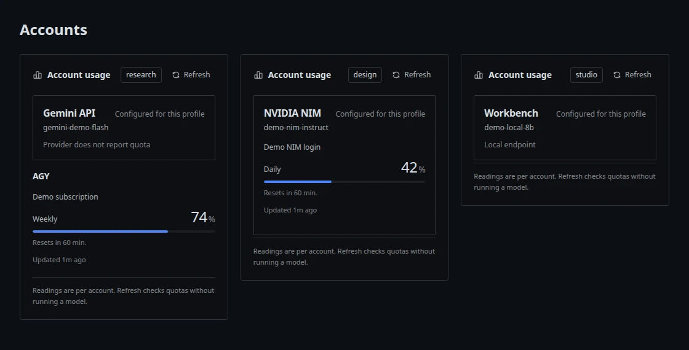

# Desktop usability

## Finding work and conversations

The rail offers **New chat**, **History** and **Search**. New chat opens a native blank tab from a chat, retaining any earlier unsent draft. Choose a chat zone first or drag **New chat** to the zone's tab strip to place the new tab there. Ctrl+T (⌘T on Mac) opens a new tab in the focused chat zone.

**Search** first lists recent conversations and commands. Type a phrase and choose **Search in messages** to see the first page of saved-chat matches on the active connection and profile. Use the arrow keys to select a chat and Enter to open it. Matched words are highlighted in message previews. If a chat matched by title or saved session ID, its result names that match and shows the preview as plain text. The results announce how many chats are shown. **Search all saved chats** carries your query into History for additional filters. Sending the same query again reapplies it after an edit in History. Going Back to an unfiltered History page clears the search. Forward reapplies the saved-chat query. Press Escape to return to commands with your query intact, then Escape again to close Search. Holding Backspace clears the query while keeping message search open. Press Backspace again on the empty field to return to commands. While an input method is composing text, Backspace stays with text editing.

When you switch devices, History and message search pause until the switch
settles. Your query stays in place, and results refresh on the active device.
History opens a saved-message match under the device and profile that
returned it, even if a loaded chat in another profile has the same ID.
If that other chat is already open, Desktop opens the result in a separate window
so the existing chat keeps its owner.
If the main tab holds an unsent new-chat draft, History opens a different
saved chat in another tab. Select the main tab to continue your draft.
Press Enter or Space on a History result to move focus into the saved
chat while it loads, including when it opens in an empty main tab. Use Back to return to the same History search.
During Local reconnect, message search waits for the gateway. You can
edit the query or choose a result already shown for that same search.
If the result opens in a split tab, focus moves to that chat while it waits
for Local. You can keep using the keyboard from there.
If the main Chat has an unsent draft, opening a saved result keeps that
draft in its own tab. A split Chat with a draft or queued messages
also stays open. Search can reuse a split tab when it is empty.
When Local is ready, search runs for the current query. A search that
already failed still offers Retry.
If a saved-chat search fails in History, use **Retry**. Activating the
focused button returns keyboard focus to the search field.

Open **Settings** from the navigation rail in Focus or Workspace. In a compact window it sits beside **History**. The Settings shortcut (⌘, on Mac, Ctrl+, on Windows and Linux) and the command palette also open Settings. Typing in Settings opens its search with the first character already entered. Standalone chat windows have a Settings gear in their titlebar.

In Hub, **Back** returns through the actual file/folder navigation history. At the starting file it returns to Hub and retains the previous search. Folder browsing and supported previews remain inside Hermes. Missing, inaccessible and unsupported files keep their existing preview gates.

A collection search names its scope. No matches are distinct from an empty collection. Use **Clear search and filters** to recover the collection or **Search all Hub** to keep the query and expand its scope. Searching does not grant bot membership or share a private chat file.

## Recovering an earlier message

Open the failed-message notice to read the full text and see any original attachments you need to review or reattach. **Park draft and edit failed message** puts the earlier text in this chat's composer and saves what you were typing. **Return to parked draft** brings back the draft and saves edits to the other message.
If saving the switch fails, a message appears beside that saved draft.
Your current draft stays in the editor and you can retry from the same row.
While previewing sent messages in the composer, press **Down Arrow** until
your current draft returns. Saved-message restore is available again then.

Review the recovered message before you press Send. Sending the original payload uses its original submission ID on a gateway that supports idempotent admission. If you revise the text or replace attachments, confirm **Send as new message**. The earlier message may already have reached the gateway.

When you discard a saved message with the keyboard, focus returns to the recovery summary while other saved messages remain. After the last discard, you can keep typing in the current draft.

When Hermes recovers an unsent draft from a deleted chat, it keeps the original saved copy until it saves the draft in the new chat. If **Undo** cannot save a restored draft back to its original chat, an error appears beside Undo. The draft stays in the editor and you can retry.

When **Restore draft** copies an unassigned draft, focus returns to the composer.
If the copy fails or the chat already has a saved draft, the notice explains
the failure and keeps **Restore draft** available.

## Checking the configured provider

**Settings → Accounts** shows the selected profile's configured provider and model on the active connection. A current per-account reading includes its timestamp. If the first read fails, Accounts shows a load error. A failed refresh keeps any cached readings visible. A provider without a reading shows that quota is unreported, while a configured local endpoint is labeled separately. Gemini API and AGY subscription reports have separate provider identities. **Refresh** checks supported quota sources and keeps keyboard focus while the request runs. If you switch devices during a refresh, returning to the same device and profile shows **Refreshing** until its request ends. When a quota window passes its reported reset time, the next display update marks that window stale until Refresh supplies a current reading. The reset time stays available by keyboard when a window becomes stale. Other windows remain visible.

The bottom-bar **Account usage** picker offers the default and active profiles.
Switching devices or active profiles returns the picker to **default**.

## Reading Workflow

**Fit graph** fits both dimensions. Large graphs may need small overview text; select a destination to highlight its recorded ancestry and use **Focus selected card** to return that task to readable size. Focusing scrolls after the scaled layout is committed. Bot journeys remain based on recorded runs and dependencies. No animation fabricates progress or dispatches work.

## Choosing and creating bots

Use **New bot** or **New group chat** in the Bots workspace header. In **Manage team**, the roster toolbar has a separate **New section** button. The standalone Bots roster keeps its creation menu.

Cards show the model and provider already reported by the roster. Missing values say **not reported**. These are configured profile values: an existing chat can retain a different model. They do not prove provider readiness or remaining allowance. The display adds no provider or quota probe.

**New bot** defaults to create-only. It creates the profile, refreshes the team and keeps the current page/profile. It does not start a chat or inference. The optional **Start an introduction after creation** control explicitly discloses that the introduction is a real model call under the bot's existing route and quota. Native readiness and confirmation gates still apply. Remote creation retains its own source routing. No paid fallback is added.

## Setting goals and keeping context

The goal editor searches enabled installed skills locally, shows the selected count and retains choices while filtering. Skill references do not enable tools, alter permissions or start a goal. Pressing Enter in skill search does not submit the form. Existing session/revision-bound saving and explicit completion criteria remain authoritative. The Save surface stays outside the form’s scroll area and uses the native opaque dialog background.

Device, profile for new chats and connection state remain visible above the workspace. The compact row preserves readability on a laptop-height window. Native device/profile selectors and draft ownership remain unchanged.

## Reconnecting to Local

Desktop reopens the Local socket after it drops, including during initial
sidebar loading. The reconnect uses a fresh ticket from the canonical gateway
and waits with jittered backoff capped at 15 seconds between attempts.
**Device & profile** shows **Connecting** during an active attempt, including
while the Local backend and fresh ticket are being prepared. Tabs and drafts
stay open. After initial startup, the automatic provider setup screen waits
for the connection to return, keeping saved Chat visible in the meantime.
The composer shows the connection status above the message field, including
when it is empty. The status wraps in narrow panes and is available to
assistive technology. It shows Disconnected when retries have stopped
and clears the status when the connection is ready. You can edit the draft
while reconnecting. **Suggest prompt** becomes available again when the
gateway is ready. Any suggestion still pending when the connection dropped
is discarded. The slash and **@** menus use local choices and fresh cached
results while reconnecting. An open search resumes when the gateway is ready.
Automatic sending of queued messages in the open Chat waits for the gateway.
Queued messages stay visible, and a queue paused with Stop stays paused.
Resume, Send, Next, Steer and the shortcut to send the next queued
message are available when the gateway is ready. You can still edit
or remove messages held on this device during reconnect. Delete and
Discard for entries held by the gateway wait for the connection. You can
keep typing an edit to a gateway-held entry and save it when Ready.
If the previous Save could not be confirmed, choose Save again after the
connection returns.
When reconnect interrupts the open Chat, it tries to resume
after the Local gateway returns. During recovery, a closed socket or
shutdown refusal uses the existing reconnect status. A split Chat shows its
connection status until the gateway is ready, then returns to its session
loader. If the Local gateway reports no startup result, the recovery
dialog keeps the original startup error under **Details**. Background
requests reuse that failure. Choose **Retry** to start a new attempt. Once
the Local gateway comes up, the chat composer is available again. If Desktop
can’t confirm the reset, the dialog keeps its open diagnostics and lets you
choose **Retry** again. Keyboard focus stays on **Retry** while Desktop waits
unless you move it.
In a small window, scroll the recovery dialog to read **Details** and recent
logs while keeping the recovery buttons reachable. Opening **Gateway settings**
from recovery moves keyboard focus to **Back**. Choose **Back** or press Escape
in Gateway settings to return to recovery and focus **Gateway settings**.
**Details** keeps its open or closed state when you return to the same startup error.
In a short window, scroll the settings panel to reach **Save and reconnect**.
If the Local reconnect request fails, the error appears next to that button.
Keyboard focus stays on **Save and reconnect** while the request is pending
unless you move it, so you can press Enter again after a refusal.
If the Local runtime refuses to start because it needs repair,
its error explains why automatic retries stop. After fixing the reported
issue, choose **Reconnect now** on the error to retry that Local connection.
If the Local gateway is incompatible or Hermes flags an unsafe control
file or folder, open **Details** for the specific repair instructions.
When you activate it by keyboard, focus moves to the Local connection
status and stays there while the retry completes.
If the retry is refused again and focus is still on the status, focus
returns to **Reconnect now**.
Open split Chats on the shared Local gateway reattach across profiles.
While a split Chat restores its runtime, it can show a read-only excerpt
of recent saved messages. The composer returns when the Chat reattaches.
If a dropped Local connection interrupts the open, the split tries again
when Local is ready. If the new attempt fails, use **Retry** in the tab.
Activating the focused **Retry** button puts focus on the chat panel
while it loads. If it fails again, press Tab to reach **Retry**.
If you were typing in that split, keyboard focus returns to its draft
unless you moved focus elsewhere during recovery.

## Verification boundaries

Regression tests and real isolated Electron interactions use disposable conversations, files, bot profiles and paused controls. Provider inference is denied and counted. Production source adoption, package preparation, graceful activation and isolated visual acceptance are separate evidence. No remote Screen transport, provider authorization, allowance or production worker execution is certified by these checks.

## Interaction safeguards (v0.6.3)

After a fitted overview, **Zoom out** always makes the graph smaller; controls disable at their manual limits. Fit can still show a larger graph at a smaller overview scale.

Closing a changed Hub document asks whether to **Keep editing** or **Discard changes**. Unchanged forms close directly, and successful saves close without a discard question. Inputs stay disabled during a pending save; a refused save keeps the draft and reports the error without retrying.

**Manage bot access** searches locally by a bot's reported name or canonical identity, shows the selected count and keeps selected members outside the search result. An existing member missing from the reported profile list remains visible with an explicit label. Filtering does not save membership or grant access.

History/Projects and Settings indicate the current destination. The navigation rail scrolls on short windows rather than leaving its lower controls inaccessible.

## Resilient searches and lighter browsing (v0.6.4)

Pasted bot-role and Hub-title queries ignore surrounding whitespace. Changing Hub's All/Pages/Images filters uses the already loaded collection list; entering or leaving Trash still reads the correct server scope. A pending list shows **Loading collection items…** instead of claiming that a collection is empty.

Saved-chat search retires results from another query or profile immediately. A failed full-text request shows a small error with **Retry**, keeps any applicable local matches, and does not reuse the previous full-text hits. There is no new retry timer or polling loop. Retry makes one new debounced search request through the existing native transport.

**Manage bot access** distinguishes a pending profile catalog, a failed read and a successfully loaded empty catalog. Existing selections remain visible and are never relabeled as missing before the catalog is available. Saving stays disabled while that read is pending or failed. Use **Retry** to recover explicitly; no membership write occurs during loading, filtering or retrying.
