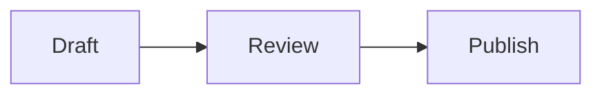

# Mermaid diagrams in Desktop

Use a Mermaid fence in an assistant reply or a Markdown file. Chat, the
Markdown preview pane, and the Hub Markdown preview share the same renderer.
Hub also offers the original file in its Source tab.

In **Work → Track work**, diagrams in a delivered result appear on the card.
Open **Task brief** to render the diagrams in the brief.

````markdown

````

When a diagram has an `accTitle`, its **Open diagram** button and viewer
include that title so screen reader users can tell diagrams apart in Chat
and on work cards.

Open the diagram to enter the zoom and pan viewer. While the viewer or its
toolbar has focus, use the arrow keys to pan. Press **+** or **=** to zoom in,
**−** to zoom out, and **0** to fit and recenter. Zooming keeps the center point
fixed. Press **Escape** to close the viewer and return focus to **Open diagram**.
If a toolbar tooltip is open, Escape dismisses the tooltip first.

In Hub's chat file preview, Escape returns from the expanded diagram to
**Open diagram**. Press Escape again to close the file preview and return to
the file in the list.
**Copy** keeps focus and runs one copy at a time in the expanded viewer.
If the clipboard rejects both image and SVG text, the expanded viewer shows
**Copy failed** above the toolbar and keeps Copy and Close in place. Open **Source** below a
rendered diagram to read the original Mermaid text. Tab into the source and
use the arrow keys or Page Up and Page Down to scroll it. In Chat, the focused
source scrolls into view above the composer. Source keeps focus while the
composer finishes opening a saved chat. **Copy source** copies the original text.
**Save SVG** saves a scalable image, and **Save PNG**
saves a raster image. The button stays focused during export. If saving
fails, select **Save PNG** again to retry. The diagram uses the app's light or dark appearance at
render time. A failed diagram shows a short explanation and its source. Choose
**Retry** after a timeout to render again while keeping the source visible. If
focus is on **Retry** or **Copy source**, it moves to **Open diagram** when
the diagram returns. If a different error removes **Retry**, focus moves
from that button to **Copy source**. Oversized diagrams show a shortened source preview.
**Copy source** still copies the complete text.

## Answer cards

An existing `cards` block can include one Mermaid diagram per card. Put the
source in the card's optional `mermaid` field, or put a Mermaid fence inside
the JSON string for `description` using escaped newlines.

````markdown
```cards
{
  "cards": [{
    "title": "Review workflow",
    "description": "Illustrative workflow.",
    "mermaid": "flowchart LR\n  Draft --> Review --> Publish"
  }]
}
```
````

## Supported diagrams and limits

Flowchart, sequence, class, state, Gantt, entity relationship, pie and mindmap
diagrams load from the local Desktop bundle. Mermaid runs at strict security
level with SVG labels inside an isolated renderer. In-diagram configuration,
custom styles, links, icon and image resources, and HTML labels are restricted.
Use plain text, or a line break within a label. SVG exports retain static SVG
and local references such as arrow markers.

Each render is limited to 12,000 characters, 160 lines, 100 edges, 512,000
characters of SVG and a five-second layout deadline enforced by Electron.
Raster exports fit within 4096 pixels per dimension. The helper starts when a
completed Mermaid fence needs rendering and closes after a brief idle period.

## Fixture verification

The [six-diagram fixture](../examples/mermaid-fixture.md) includes an invalid
fence. The light and dark captures use the Desktop components with synthetic
content. An isolated Linux Electron run also decoded all eight diagram types
in both themes, opened the exported SVG as a document, rejected active input,
and terminated a stalled helper while the main window stayed responsive.

[Light-theme fixture](images/mermaid-fixture-light.webp) ·
[Dark-theme fixture](images/mermaid-fixture-dark.webp)
