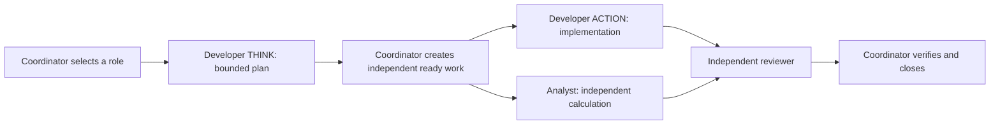

# Bounded native THINK/ACTION parallel acceptance

The v0.7.21 owning-source CLI repair was followed by one new synthetic native
worker graph on the same frozen source. The entire bounded case completed.
This evidence-only release leaves all source patches, runtime defaults, quotas,
providers, effort ceilings and Desktop assets unchanged.

## What actually ran

Native workers, task contracts, claims, completed-plan binding and review were
used. The coordinator created both independent ready cards before waiting.
ACTION could write only `aggregate.py`; Analyst could write only `reference.json`
and calculated from the supplied synthetic records without reading implementation.
Reviewer ran the unchanged independent verification script after both handoffs.

The private test driver explicitly advanced native dispatcher stages and checked
each receipt. This proves bounded native handoffs and genuine simultaneous work;
it does not prove continuous, unattended production scheduling or eliminate the
need to validate a real Captain's existing configuration.

| Controlled role | Model | Effort | Physical requests |
| --- | --- | --- | ---: |
| Coordinator, across three separate cards | GPT-6.1 Sol | high | 18 |
| Developer THINK | GPT-6.1 Sol | high | 3 |
| Developer ACTION | GPT-6.1 Terra | high | 6 |
| Independent Analyst | GPT-6.1 Terra | high | 4 |
| Independent Reviewer | GPT-6.1 Sol | high | 5 |
| **Total** | | | **36 of the 42-request ceiling** |

Six native cards completed through seven native runs, including ACTION's
`review_requested` handoff and the reviewer's completed run on that same card.
There were no task retries, duplicate cards, provider fallback or paid fallback.
The private concurrency limits were two total and one per profile, below the
unchanged production limits. No effort exceeded high.

## Completion and overlap evidence

- Nine independent artifact checks passed: specified aggregation, settled-only
  filtering, integer totals/counts, sorted keys, empty input, zero/negative values
  and input preservation. Supplied inputs and verification script were unchanged.
- ACTION and Analyst native run intervals overlap for 18 seconds. Separately,
  completed main model request intervals overlap for **13.839283 seconds** across
  seven segments. Running labels alone are not the basis for the parallel claim.
- Each worker session's last tool is its native terminal handoff. No tool or model
  call follows that handoff, and a further 15-second observation records no new
  requests after final completion. This is a bounded observation, not a claim
  about future work.
- The provider reported 532,015 input tokens including 401,792 cached input tokens
  across the 36 requests. These are observed token counts, not a before/after
  savings estimate, a billing statement or proof of cross-bot cache reuse.

The case used a synthetic Sol coordinator on an existing authorized account.
The original user Captain's model, active sessions, source/configuration, quota
and emergency-stop state were preserved. This is not original-user adoption or
all-provider/all-role acceptance. Other unadmitted role pairs remain held.

## Reproduce without crossing production boundaries

Use an explicitly authorized synthetic fleet and nonconflicting disposable
workspace. Verify current account, role admission, claims, limits and native
readiness before starting; a saved routing snapshot does not grant authority.
Use `hermes profile list --routing-json` once when current routing metadata is
needed. Keep native completed THINK-plan binding and independent review.

Keep the test source and its launcher aligned with the installed source. A managed
store-Python launcher under an arbitrary temporary home may legitimately refuse
when that namespace has no committed dependency environment. Do not remove the
lazy-install guard or invent PM facts. This case instead used a detached matching
unmanaged source snapshot, the existing dependency-carrying interpreter and the
native minted source launcher. Its preflight saw only the five synthetic profiles
before the first model request. No dependencies or environment selections changed.

Bound physical requests across child processes, not just logical turns. Refuse
foreign endpoints, models, higher efforts and fallback before network access.
Record task/run linkage, request interval metadata and native terminal receipts;
do not publish prompts, credentials, account IDs, host paths or user transcripts.
On refusal, ambiguity or budget exhaustion, retain the real outcome without
replay, forced status changes or raising production limits to get a passing run.

Two earlier failed coordinators remain failed/non-replayed history. Their different
outcomes are not a cost baseline. Offline and installed Linux/macOS checks for
the source repair are in [the routing snapshot guide](profile-routing-snapshot.md).
The real parallel-provider case ran on Linux; it does not claim a second live
provider run on macOS. Both hosts retain the same verified source patch payload.
