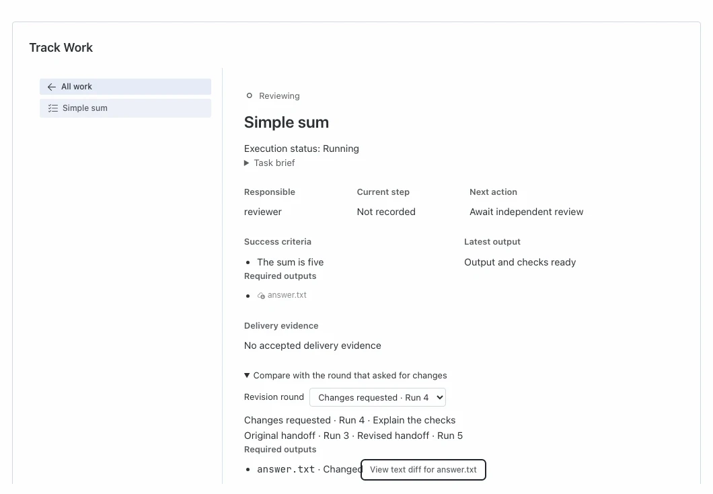

# Hermes Legion v0.36.0 — Owner Inbox and Work Cards

## What you will notice

- **Waiting for owner** collects pending bot questions and approvals across
  profiles on the active connection. Answer in the inbox or open the bot's chat.
  Local questions with a linked Work card can open that card in its profile.
  If a reply fails, the draft stays available for retry.
- **Work** flags recorded path overlaps so teams can coordinate before editing
  the same place. Track Work shows delivery evidence and lets you choose an
  earlier revision round and open a text diff when both recorded files are still
  available. Reviewed results show the recorded usage when the gateway has it.
- **Accounts** shows the provider for the active profile. Chat can recover
  eligible unsent text after a failed send or reopen. Saved-message search
  opens the saved conversation in its original connection and profile.
- **Local** offers reconnect in place when available. Desktop also explains
  SSH states such as queued, disconnected or waiting for capacity when that
  information is available. On macOS, SSH ownership checks preserve
  spaces in installer paths.
- **Mermaid** renders offline in chat, Work cards and Hub Markdown previews.
  Keyboard users can reach diagram and chart controls, and diagrams offer
  source viewing and copying. [Mermaid guide](mermaid-diagrams.md)

## Desktop fixes

Keyboard focus stays visible and returns to the relevant control after common
actions in Inbox, Work, Bots and previews. Narrow windows keep form fields and
dialog actions reachable. Bots uses visible labels for profile and model fields,
and New group chat announces when a bot search has no matches. Delayed replies,
profile switches and failed refreshes received targeted fixes across Inbox,
chat, Accounts and Work.

## Mac evidence

These captures use synthetic Local data. The Inbox fixture exercised two
profiles, a failed answer and a retry. The Work fixture exercised earlier
revision rounds and requested a text diff from recorded fixture handoffs.

The full local macOS Desktop test run on integration commit `d1e4800`
discovered 1,836 test files. It recorded 16,795 passing tests, 37 skips
and zero failures. The macOS release patch also passed Desktop typecheck
for the renderer, Electron, end-to-end tests and packaging configuration.

A separate Apple Silicon trial built Desktop offline with cached
Electron 44.9.3. On relaunch, Desktop restored a synthetic chat absent
from the first 50 history results. Both launches used the same
foreground Local gateway. The test sent zero inference prompts.
In the same isolated setup, Settings showed Local gateway selected.
Searching Bots for the seeded profile narrowed the results to its
This device card, and Edit profile opened the matching profile.

In another isolated Local trial, Bots → Monitor showed a seeded worker's
task, step and increasing elapsed time. Search and the Working filter
found the worker. After the fixture marked it done, Refresh removed it
from current work and Recent reports showed its completed report. The
test exercised stored activity and sent zero inference prompts.

The isolated Local Desktop also reopened a synthetic legacy Desktop reply from Chat
history. Its Markdown table, chart values and Mermaid diagram rendered.
Escape returned focus from the diagram viewer to its opener, and the
source matched the saved text. Both stored messages stayed unchanged.

The packaging check now refuses missing lock-pinned builder packages
before starting a build. The current Mac package trial stopped at the
missing arm64 preparation receipt.

Packaged Desktop and the owner's installed app still need verification.

A single macOS Python 3.14.9 run covered all 1,547 declared files.
It recorded 15,021 passing tests, 228 skips and zero failures.
Eight plugin test files used an isolated PM worker fixture prepared
from local dependencies. Frozen PM acquisition remains open.

Loopback OpenSSH checks cover connection reuse, helper admission and cleanup,
and reconnect backoff. The owner's installed Hermes.app, the real ai backend,
and tablet-to-Desktop answer recovery are outside this release's verification.
[Desktop SSH evidence](desktop-ssh-resources.md)

## Adopt the source kit

Use the [consolidated stable source kit](stable-full-kit.md) with the pinned
upstream revision. Follow the [Mac guide](macos-install-update.md) to rebuild
Desktop in a separate trial with its own home and a Local-only connection.
Keep the existing installation available while you try the new build.
[Installation and rollback](installation-and-rollback.md)
