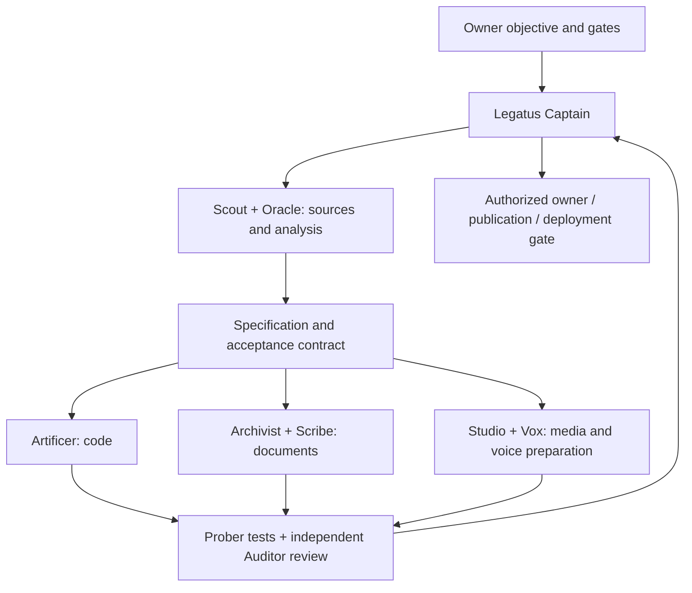

# Captain-led parallel workflow

The Captain checks existing cards and latest owner answers before creating anything. It reads the project's HANDOFF/RUNBOOK or equivalent contract, then records expected inputs, artifacts, evidence, ownership and dependencies on the canonical native task. One intent uses one card; completed work is not reopened just to obtain another response.

Research/analysis prepares the specification. Independent production tasks run in parallel only when their inputs, rights, resources, native capacity and disjoint write scopes are ready. Use provider twins and Web specialists according to actual eligibility. A held deployment does not stop unrelated authorized document/test preparation. A queued worker is not a running worker.

Review and testing follow the real dependency graph. A producer does not approve itself; a new alias or a different account alone does not establish independent review. Check exact artifact revisions/hashes and the task's acceptance criteria. Keep bounded revision/review budgets in the project contract rather than hardcoding one person's project policy.

Before waiting, classify remaining tasks as READY, DEPENDENCY, RESOURCE or APPROVAL. Start eligible independent ready work once. Keep the operation ID of a long script and wait on completion without repeated model polling or redispatch. A timeout is not non-delivery proof. Notify on meaningful completion, failure or material owner input only.

`legion_plan.py` illustrates **routing recommendations** for that workflow. It does not create cards, assign profiles, acquire native claims, enforce live filesystem scopes or replace Hermes dispatch. Those operations remain native and must repeat current ownership/eligibility checks before execution.
